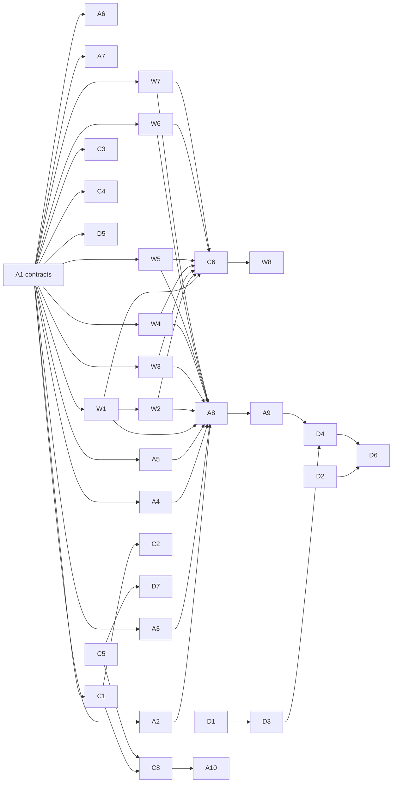

# Celik: implementation plan, 10-18 Nov 2026

> Written 7 Nov 2026 from docs/feature-plan.md. Decisions D35-D44 in docs/DECISIONS.md back every rule here and win
> if anything disagrees. Requirements: docs/SRS.md section 3.8. Design: docs/SDS.md sections 3, 4.6, 5.9 and 6.4.

Four people build seven finalist features in parallel, each editing only the files they own. Akmal writes the shared
contracts on Tue 10 Nov by 13:00; after that nobody waits for anybody. Code freezes on Sun 15 Nov at 20:00; the
pitch is Wed 18 Nov.

| Person | Lane | Total (P0-P2) |
| --- | --- | --- |
| **A. Akmal** | Lead: engine, state, shell, integration, release | 28 h |
| **B. Wafi** | Builder: the new feature screens and their tests | 26 h |
| **C. Danish** | Content: content files, BM/EN wording, fact checks | 16 h (+5 h P2) |
| **D. Aimar** | Pitch: business model, validation test, explainer art, slides, demo | 27 h |

---

## G. Session settings (do this first, everyone)

Every Claude Code session on this project runs **Opus 5.5 with effort no higher than medium**, subagents included
(D44). Opus 5.5 already starts at medium in Claude Code; the settings below make medium a cap, so `/effort high`,
`--effort`, `CLAUDE_CODE_EFFORT_LEVEL` or a subagent's frontmatter cannot push it higher.

The project file `.claude/settings.json` (committed with this plan) holds:

```json
{
  "model": "claude-opus-5-5",
  "maxEffortLevel": "medium",
  "env": {
    "CLAUDE_CODE_SUBAGENT_MODEL": "claude-opus-5-5"
  }
}
```

| Key | What it does |
| --- | --- |
| `model` | The model every session in this folder starts with |
| `maxEffortLevel` | Caps effort for every source: `/effort`, `--effort`, `CLAUDE_CODE_EFFORT_LEVEL`, skill and subagent frontmatter, model default. Needs Claude Code v2.1.267 or later |
| `env.CLAUDE_CODE_SUBAGENT_MODEL` | Default model for subagents (a subagent's own `model:` frontmatter can still override it; do not write one that picks another model) |

Check once per machine:
1. `claude --version` shows 2.1.267 or later (update Claude Code if not).
2. Start `claude` in the project folder, type `/model` and `/effort`: they should show Opus 5.5 and medium.
3. Do not set `CLAUDE_CODE_EFFORT_LEVEL` in your shell profile; the cap still applies, but it hides what you chose.

Sources: Claude Code docs, "Model configuration: adjust effort level" (https://code.claude.com/docs/en/model-config)
and the settings reference for `maxEffortLevel`. Confirm the key names there if Claude Code warns about them.

---

## A. Priority levels

| Level | Meaning | Rule |
| --- | --- | --- |
| **P0** | Blocks other people, or blocks the 18 Nov demo | Done first; Akmal's contracts are P0 |
| **P1** | Shown in the 18 Nov demo or pitch | Done before the code freeze (Sun 15 Nov, 20:00) |
| **P2** | Only if time allows | Start only when your P1 tasks are done |
| **P3** | After the competition | Not built now; listed so nobody starts them |

---

## B. Contracts (Akmal, Tue 10 Nov, merged by 13:00)

The contracts are the only time one person creates files that another person then owns. Each file below is created
once by Akmal, merged to `main`, and then **handed over**: from that moment only the new owner edits it.

| # | File | What Akmal puts in it | Owner after 13:00 |
| --- | --- | --- | --- |
| 1 | `app/src/engine/types.ts` | Types `FeedPost`, `FeedKind`, `FeedCall`, `ShopItem`, `Goal`, `Classmate`, `Explainer` (SDS 4.6) | Akmal |
| 2 | `app/src/engine/schemas.ts` | zod schemas and loaders for the five new content files | Akmal |
| 3 | `app/src/engine/feed.ts` + `feed.test.ts` | `judgePost(post, call)` stub returning a fixed result | Akmal |
| 4 | `app/src/engine/shop.ts` + `shop.test.ts` | `buyItem(state, itemId)` and `itemPrice(itemId)` stubs | Akmal |
| 5 | `app/src/engine/goals.ts` + `goals.test.ts` | `goalProgress(state)` and `goalReached(state)` stubs | Akmal |
| 6 | `app/src/engine/papan.ts` + `papan.test.ts` | `rankClassmates(playerGrade)` stub | Akmal |
| 7 | `app/src/engine/balance.ts` | New sections `suapan`, `kedai`, `matlamat`, `papan` with first-guess numbers (SDS 5.9) | Akmal |
| 8 | `app/src/state/game.ts`, `app/src/storage/db.ts` | New saved fields `goal`, `purchases`, `feed` and their actions (stubs); Dexie version bump | Akmal |
| 9 | `app/src/shell/routes.tsx`, `app/src/shell/HomeScreen.tsx` | Routes and home tiles `/suapan`, `/kedai`, `/papan` | Akmal |
| 10 | `app/src/shell/i18n/index.ts` | Merges every `app/src/modes/*/i18n.ms.json` and `i18n.en.json` into the dictionaries (`import.meta.glob`, eager) | Akmal |
| 11 | `app/src/modes/semester/Dompet.tsx`, `ReportCard.tsx`, the week-0 split screen; `app/src/modes/kad/KadIlmu.tsx` | Slots: `<GoalPicker/>` after the week-0 split, `<GoalBar/>` in Dompet, `<GoalResult/>` and `<ShareButton/>` on the report card, `<ExplainerSlot concept=.../>` in Kad Ilmu. Each imports from Wafi's folders | Akmal |
| 12 | `app/scripts/check-content.ts` | Runs the banned-name, URL and phone-number checks on the five new content files | Akmal |
| 13 | `app/src/modes/suapan/Suapan.tsx`, `kedai/Kedai.tsx`, `papan/Papan.tsx`, `matlamat/GoalPicker.tsx`, `matlamat/GoalBar.tsx`, `matlamat/GoalResult.tsx`, `kongsi/ShareButton.tsx`, `tonton/ExplainerSlot.tsx`, each folder's `i18n.ms.json` and `i18n.en.json` | Placeholder components that render "Akan datang", and empty dictionaries | **Wafi** |
| 14 | `content/feed.json`, `content/shop.json`, `content/goals.json`, `content/classmates.json` | One valid example entry each | **Danish** |
| 15 | `content/explainers.json`, `assets/explainers/README.md` | One example explainer (2 frames) | **Aimar** |

Contract is done when: `npm run check` (types, unit tests, content check) passes, every placeholder route opens, and
Playwright still passes. Until 13:00, Wafi sketches screens, Danish drafts feed posts in a plain document, and Aimar
books students: nobody is blocked.

---

## C. Task list (by priority, then dependency)

Every row has one owner; every file in "Files" belongs to that owner (check table below). "Depends on" points only at
the contracts or at earlier tasks, so there are no cycles. Engine stubs mean Wafi never waits for Akmal's real logic.

### P0

| ID | Owner | Task | Files | Depends on | Est. (h) | Done when |
| --- | --- | --- | --- | --- | --- | --- |
| A1 | Akmal | Contracts (section B) | Section B rows 1-15 | - | 5 | `npm run check` green; placeholders open; merged to `main` by 13:00 Tue 10 Nov |
| D1 | Aimar | Book 10-20 students for the before/after test (SRS 5.3) | `research/validation/participants.md` (no names: counts and times only) | - | 1 | Slot booked for Sat 14 Nov |

### P1

| ID | Owner | Task | Files | Depends on | Est. (h) | Done when |
| --- | --- | --- | --- | --- | --- | --- |
| A2 | Akmal | `judgePost()` real logic, feed results into Imuniti, Celik Kewangan and XP | `engine/feed.ts`, `engine/feed.test.ts`, `state/game.ts` | A1 | 3 | Unit tests for all 9 kind × call pairs pass |
| A3 | Akmal | `buyItem()`: pay from Duit, log as Kehendak or Keperluan, bicycle cuts weekly transport, instalment item opens Kos Sebenar preset | `engine/shop.ts`, `engine/shop.test.ts`, `engine/week.ts`, `engine/balance.ts`, `state/game.ts` | A1 | 4 | Tests: "buy nothing" and "buy everything" semesters both reach week 12; Duit never below RM0 |
| A4 | Akmal | `goalProgress()`, `goalReached()`, report-card line, XP bonus | `engine/goals.ts`, `engine/goals.test.ts`, `engine/report.ts`, `modes/semester/ReportCard.tsx` | A1 | 2 | Tests for each of the 4 goals |
| A5 | Akmal | `rankClassmates()` | `engine/papan.ts`, `engine/papan.test.ts` | A1 | 1 | Player is placed correctly at grades 0, 65.5 and 100 |
| A6 | Akmal | Fix wave from HANDOFF (code items only: chat order guard, `canBeginWeek`, autosave flush, Cek Harian hidden-tab clock, midnight ComeBack, `Kalkulator.tsx:32` preset, `KadBook.tsx:529` aria-label, SemakSim dash match) | Files named in HANDOFF, all in Akmal's lane | A1 | 4 | Each item has a test or a Playwright check |
| A7 | Akmal | Daily merges at 20:00 (Tue-Sun) | `main` | A1 | 3 | Every merge followed by green `npm run check` and Playwright |
| A8 | Akmal | Performance pass: 4x CPU throttle, lazy-load the new modes, size check | `vite.config.ts`, `shell/routes.tsx` | A2-A5, W1-W7 | 3 | `npm run size` under 8 MB; 30 fps at 4x throttle |
| A9 | Akmal | Deploy to Netlify, offline check on 2 phones, backup demo recording | `netlify.toml`, `main` | A8 | 3 | Deployed link works in airplane mode on 2 phones |
| W1 | Wafi | Suapan feed: post cards, author, scroll | `modes/suapan/*` | A1 | 4 | Renders `content/feed.json` at 3 viewports |
| W2 | Wafi | Suapan actions: Percaya / Semak / Lapor, debrief sheet, Semak opens Kalkulator or Kad Ilmu | `modes/suapan/*`, `app/e2e/suapan.spec.ts` | W1 | 4 | Playwright: "2% a day" post → Semak → Semak Pulangan shows the Terlalu Lumayan flag |
| W3 | Wafi | Kedai Kampus: shelf, confirm sheet, instalment item shows total cost first | `modes/kedai/*`, `app/e2e/kedai.spec.ts` | A1 | 5 | Playwright: buying the phone shows Kos Sebenar before confirm |
| W4 | Wafi | GoalPicker, GoalBar, GoalResult | `modes/matlamat/*`, `app/e2e/matlamat.spec.ts` | A1 | 3 | Playwright: pick a goal at week 0, bar visible in Dompet |
| W5 | Wafi | Papan Markah screen | `modes/papan/*`, `app/e2e/papan.spec.ts` | A1 | 2 | Player row highlighted among 10 |
| W6 | Wafi | Kad Keputusan: ShareButton renders a 1080×1350 card with `html-to-image` (already a dependency) | `modes/kongsi/*`, `app/e2e/kongsi.spec.ts` | A1 | 3 | Downloads a PNG with SIMULASI label and character name, no text input |
| W7 | Wafi | Tonton: ExplainerSlot with frame player (tap or auto-play, reduced-motion aware) | `modes/tonton/*`, `app/e2e/tonton.spec.ts` | A1 | 3 | Plays the example explainer offline |
| W8 | Wafi | Screenshots at 360×800, 412×915, 1920×1080 for all new screens; apply Danish's wording review | `modes/<feature>/i18n.*.json`, `app/e2e/finalist-screens.spec.ts` | W1-W7, C6 | 2 | Screenshots saved; no layout overflow |
| C1 | Danish | 20 feed posts in BM: 8 advice, 6 hype, 6 scam; every hype post has a debrief | `content/feed.json` | A1 | 5 | `npm run check:content` passes |
| C2 | Danish | Feed posts in EN | `content/feed.json` | C1 | 2 | Every post has `en` text |
| C3 | Danish | Shop item text (prices stay in `balance.ts`, Akmal's) | `content/shop.json` | A1 | 1.5 | 8-10 items, each with pot and effect |
| C4 | Danish | Goals and classmate names | `content/goals.json`, `content/classmates.json` | A1 | 1 | Fictional names only; checker passes |
| C5 | Danish | Verify the legal lines and example rates shown in the demo; record sources | `shell/i18n/ms.json`, `shell/i18n/en.json`, `content/concepts.json`, new `docs/verification-log.md` | - | 3 | Each demo line has an official source or is reworded to a safe general line |
| C6 | Danish | BM native read of all new copy; review list for Wafi's i18n files | `docs/verification-log.md` (review list section) | W1-W7 | 2 | List handed to Wafi by Sat 14 Nov |
| C7 | Danish | Missing EN keys from HANDOFF (`rapor.*`, `kad.*`) | `shell/i18n/en.json` | - | 1 | `english.test.ts` passes |
| D2 | Aimar | Business one-pager and cost model | `docs/business/model.md` | - | 3 | Free-for-students licence model, pilot plan, price [TO FILL] |
| D3 | Aimar | 12-question test (6 money, 6 scam) and answer key | `research/validation/test.md` | D1 | 2 | Reviewed by Danish for accuracy (comments only) |
| D4 | Aimar | Run the test before and after one session; analyse | `research/validation/results.md` | D3, A9 or a dev build | 4 | Before/after scores, n, and one honest limitation |
| D5 | Aimar | Explainer art: compound growth and cost of debt (6-8 SVG frames each, BM/EN captions) | `assets/explainers/*`, `content/explainers.json` | A1 | 7 | Both play in Tonton; under 150 KB together |
| D6 | Aimar | Slides | `docs/pitch/slides.*` | D2, D4 | 6 | Rehearsed twice |
| D7 | Aimar | Demo script and Q&A sheet (facts cite `docs/verification-log.md`) | `docs/pitch/demo-script.md`, `docs/pitch/qa.md` | C5 | 4 | Demo fits 3 minutes; 10 Q&A answers |

### P2 (only if time allows)

| ID | Owner | Task | Files | Depends on | Est. (h) |
| --- | --- | --- | --- | --- | --- |
| C8 | Danish | Raya event pack: one festive scenario (duit raya budget, fake e-greeting app) in BM and EN | `content/scenarios/raya_duit.ink`, `content/scenarios/en/raya_duit.ink` | C1-C5 | 5 |
| A10 | Akmal | Slot Raya into the schedule as an optional week event; adaptive order (FR-72) | `engine/scheduler.ts`, `content/semester.json` is Danish's: Akmal asks Danish to add the entry | C8 | 2 |

### P3 (after the competition; do not start)

Cosmetic shop, Mod Sindiket, online campus leaderboards, Suapan with real user posts, financial-literacy videos on
social media, university dashboard (D42).

### Dependency graph



No arrow points backwards, so there are no cycles. After A1 merges, every person has at least two tasks they can
start without waiting.

### File → owner check

| File or folder | Owner | Tasks |
| --- | --- | --- |
| `app/src/engine/**`, `state/**`, `storage/**`, `ui/**` | Akmal | A1-A6 |
| `app/src/shell/**` except `i18n/ms.json`, `i18n/en.json` | Akmal | A1, A8 |
| `app/src/shell/i18n/ms.json`, `en.json` | Danish | C5, C7 |
| Existing `app/src/modes/{semester,kad,kalkulator,harian,drills,classmode}/**` | Akmal | A1, A4, A6 |
| `app/src/modes/{suapan,kedai,matlamat,papan,kongsi,tonton}/**` incl. their i18n files | Wafi | W1-W8 |
| Existing `app/e2e/*.spec.ts`, `helpers.ts` | Akmal | A6 |
| New `app/e2e/{suapan,kedai,matlamat,papan,kongsi,tonton,finalist-screens}.spec.ts` | Wafi | W2-W8 |
| `app/scripts/**`, `package.json`, lockfile, `vite.config.ts`, `playwright.config.ts`, `netlify.toml`, `.claude/settings.json` | Akmal | A1, A8, A9 |
| `content/**` except `explainers.json` | Danish | C1-C5, C8 |
| `content/explainers.json`, `assets/explainers/**` | Aimar | D5 |
| `docs/verification-log.md` | Danish | C5, C6 |
| `docs/business/**`, `docs/pitch/**`, `research/validation/**`, `submission/**`, `video/**` | Aimar | D1-D7 |
| `docs/SRS.md`, `SDS.md`, `DECISIONS.md`, `IMPLEMENTATION-PLAN.md`, `CLAUDE.md` | Akmal | changes go through Akmal |

No file appears under two owners. A10 is the one place two lanes meet: Akmal asks Danish to add the Raya entry to
`content/semester.json` rather than editing it.

---

## D. Schedule, 10-18 Nov

10-11 Nov is low-regret work that helps even if Celik is not shortlisted on 12 Nov.

| Day | A. Akmal | B. Wafi | C. Danish | D. Aimar |
| --- | --- | --- | --- | --- |
| **Tue 10** | A1 contracts by 13:00; A6 fix wave | Sketch screens until 13:00; W1 | Draft posts in a doc; C1 after 13:00 | D1 book students; D2 |
| **Wed 11** | A2; merge | W2 | C1 finish, C2 | D2 finish; D3 |
| **Thu 12** (shortlist) | A3; merge | W3 | C3, C4, C7 | If shortlisted: D5 starts. If not: stop and write up |
| **Fri 13** | A4, A5; merge | W4, W5 | C5 | D5 (compound growth) |
| **Sat 14** | A6 finish; merge | W6, W7 | C6 review list to Wafi; C8 if time | D4 run the test; D5 (cost of debt) |
| **Sun 15** | A8; final merge; **code freeze 20:00** | W8 | C8 if time | D4 analysis; D6 slides v1 |
| **Mon 16** | A9 deploy, 2-phone offline check | Fixes only (bugs Akmal assigns) | Proofread on the deployed app | D7 demo script; rehearsal 1 |
| **Tue 17** | Backup phone, offline recording | Rehearse demo path | Check `docs/pitch/qa.md` facts | D6 final; D7 Q&A; rehearsal 2 |
| **Wed 18** | Runs the demo at PICC | Backup demo phone | Answers fact questions | Presents |

---

## E. Branches, merges and requests

1. One branch per person from `main` after A1: `lane/akmal`, `lane/wafi`, `lane/danish`, `lane/aimar`.
2. Akmal merges every evening at 20:00, in this order: Danish, Wafi, Aimar, Akmal. After each merge:
   `npm run check` and `npm run e2e`.
3. A red build goes back to its owner the next morning; the others keep merging, because no files are shared.
4. Rebase your branch on `main` each morning before you start (no conflicts are possible if you stay in your lane).
5. **Need a change in someone else's file?** Post it in the team chat as "REQ: file, change, why". The owner does it
   the same day or replies why not. Never edit it yourself.
6. New npm packages, `balance.ts` numbers and the docs in `docs/` (except your own folders) go through Akmal.
7. 15-minute stand-up each morning: yesterday, today, open REQs.

---

## F. Plugins and tools per person

Install Claude Code plugins with `/plugin` inside Claude Code (search the marketplace by name). Nothing below adds a
run-time network call to the app; Playwright stays a dev dependency (D12).

| Tool | What it does | Akmal | Wafi | Danish | Aimar | How |
| --- | --- | --- | --- | --- | --- | --- |
| **superpowers** (plugin) | Skills for brainstorming, writing-plans, test-driven-development, systematic-debugging, verification-before-completion | Yes | Yes | verification only | - | `/plugin`, search "superpowers". Akmal: TDD for every engine function; everyone: verification before saying "done" |
| **frontend-design** (plugin skill) | Guidance for distinctive UI that follows a design direction | - | Yes | - | Optional (slides) | `/plugin`, search "frontend-design". Wafi follows docs/UI-SPEC.md first; the skill only fills gaps |
| **Playwright** (dev dependency, already in `package.json`) | End-to-end tests, offline mode, screenshots | Yes | Yes | - | - | Once per machine: `cd app && npx playwright install chromium` |
| **Context7** (MCP) | Fetches current library docs | Optional | Optional | - | - | Not connected here (D12); use each package's type definitions and official site instead |
| **Chrome DevTools** (MCP) | Performance traces with CPU throttling | Optional (A8) | - | - | - | Only if already connected; otherwise use Chrome's own DevTools Performance tab at 4x CPU slowdown |
| **Inky** (desktop app, not a plugin) | Writes and tests ink scenarios | - | - | Yes (C8) | - | Free from inklestudios.com |
| SVG editor (Inkscape or Figma) | Draws explainer frames | - | - | - | Yes (D5) | Export plain SVG, no embedded fonts or images |

Rules for everyone: one Claude Code session per lane branch; start each session from your starter prompt (section H);
never let a session edit files outside your lane.

---

## H. Starter prompts (paste into your first Claude Code session)

Each person opens Claude Code in `D:\FinancialLiteracy-ScamAwareness` on their own branch.

### A. Akmal

```
I am Akmal, the Lead for Celik. Read CLAUDE.md, docs/DECISIONS.md (D35-D44), docs/IMPLEMENTATION-PLAN.md,
docs/SRS.md 3.8 and docs/SDS.md 4.6, 5.9 and 6.4. Work on branch lane/akmal.
My lane: engine/, state/, storage/, shell/ (not i18n ms.json/en.json), ui/, existing modes/*, existing e2e specs,
scripts/, package.json, configs, netlify.toml. Edit nothing else.
Today: task A1 (contracts, section B). Use superpowers test-driven-development for each engine stub's test, then
verification-before-completion. Done when npm run check and npm run e2e pass and every placeholder route opens.
Then A6. Stop and ask me before changing a hard rule or a file outside my lane.
```

### B. Wafi

```
I am Wafi, the Builder for Celik. Read CLAUDE.md, docs/DECISIONS.md (D35-D44), docs/IMPLEMENTATION-PLAN.md,
docs/UI-SPEC.md, docs/SRS.md 3.8 and docs/SDS.md 4.6 and 5.9. Work on branch lane/wafi, rebased on main after A1.
My lane: app/src/modes/{suapan,kedai,matlamat,papan,kongsi,tonton}/ including their i18n.ms.json and i18n.en.json,
and the new e2e specs for those features. Edit nothing else; ask the owner with a REQ.
Today: W1, then W2. Code against the engine stubs from A1; do not reimplement engine logic in the UI.
Follow UI-SPEC tokens; use frontend-design only where UI-SPEC is silent. Check 360x800, 412x915 and 1920x1080 with
Playwright and keep the DEMO watermark working. Stop and ask before adding a package.
```

### C. Danish

```
I am Danish, the Content owner for Celik. Read CLAUDE.md (hard rules 1, 2, 4, 11, 12), docs/DECISIONS.md
(D27, D35-D42), docs/IMPLEMENTATION-PLAN.md and docs/SDS.md 4.6. Work on branch lane/danish.
My lane: content/ (except explainers.json), content/scenarios/ incl. en/, app/src/shell/i18n/ms.json and en.json,
allowed-real-names.txt, banned-names.txt, docs/verification-log.md. Edit nothing else.
Today: C1, 20 feed posts in BM (8 advice, 6 hype, 6 scam), fictional accounts only, .test links and 01X-0000 0NNN
numbers only, every hype post with a debrief, no product recommendations. Validate with npm run check:content.
Mark any legal line or rate I cannot source as TODO-VERIFY. Stop and ask before using a real name.
```

### D. Aimar

```
I am Aimar, the Pitch owner for Celik. Read README.md, docs/feature-plan.md (business model), docs/SRS.md 5.3 and
docs/IMPLEMENTATION-PLAN.md. Work on branch lane/aimar.
My lane: docs/business/, docs/pitch/, research/validation/, assets/explainers/, content/explainers.json,
submission/, video/. Edit nothing else.
Today: D1 (book students; store counts and times only, never names) and D2 (business one-pager: free for students,
universities licence an orientation package, grant or sponsor funds the pilot, sponsors never appear as brands or
advice). Leave the price per student as [TO FILL].
Next: D5 explainer frames as plain SVG with BM/EN captions; content/explainers.json must pass npm run check:content.
```
